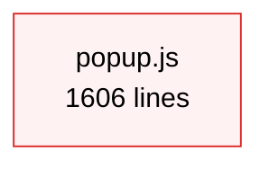
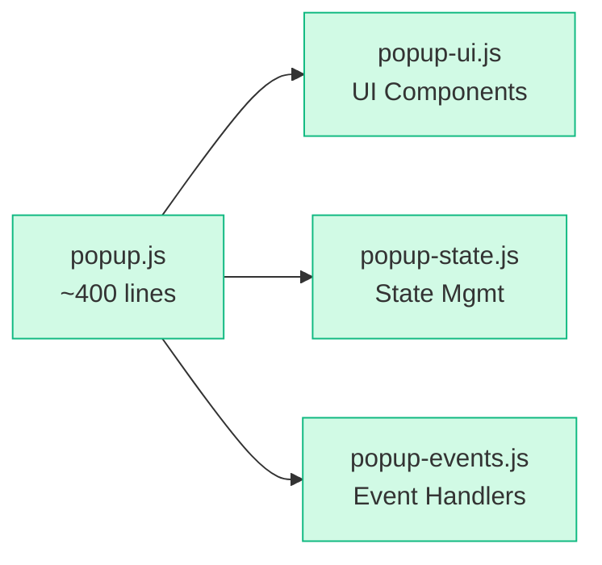
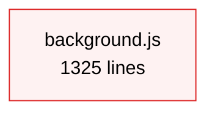
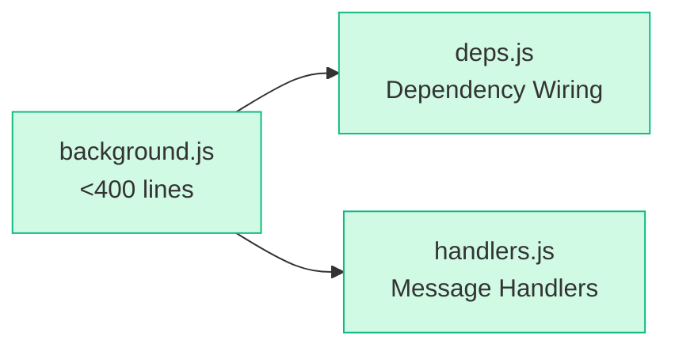
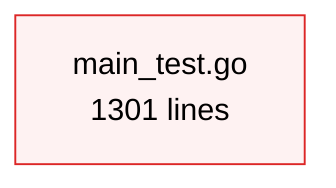
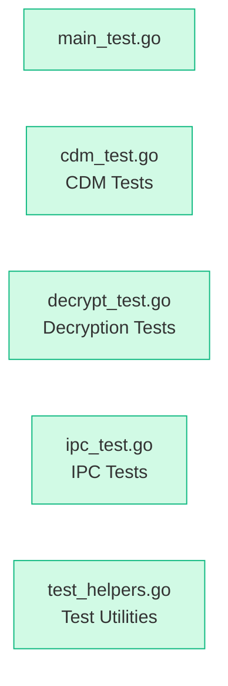

# Audit Report: qwin

**Generated:** June 22, 2026
**Project Type:** Chrome/Firefox/Yandex browser extension (video downloader) with Python native host and Go CDM module
**Source Files Scanned:** 144 files (excluding `.git/`, `node_modules/`, `dist/`, `__pycache__/`, `.ruff_cache/`, `.opencode/`, `.claude/`)

## Executive Summary

The qwin codebase is well-organized with a logical modular structure (background, content, popup, shared, native-host, Go modules). However, it suffers from **significant file bloat** — 20 files exceed the 400-line threshold, with the top three files (`popup.js` at 1606 lines, `background.js` at 1325 lines, `go/main_test.go` at 1301 lines) being critical refactoring targets. There is an **empty dead directory** (`src/adblock/`) suggesting abandoned work, and the `tests/extension/` directory has 31 files — just over the recommended 30-file limit. Naming conventions are largely consistent within domains. Doc files are well-organized into `docs/`.

## Severity Legend

- 🔴 **Blocker** — must fix
- 🟡 **Warning** — should fix
- 🟢 **Suggestion** — nice to improve

---

## Issues Found

### Phase 1: Quick Cleanup
_Low effort, safe changes._

- [ ] **Remove empty/dead `src/adblock/` directory** — appears to be an abandoned ad-blocking feature stub. The empty `dist/chromium/src/adblock/`, `dist/firefox/src/adblock/`, `dist/yandex/src/adblock/` are generated copies that will also disappear after rebuild.

  **Before:**
  ```
  src/
  ├── adblock/          ← empty directory
  ├── background/
  ├── content/
  ├── native-host/
  ├── popup/
  └── shared/
  ```

  **After (proposed):**
  ```
  src/
  ├── background/
  ├── content/
  ├── native-host/
  ├── popup/
  └── shared/
  ```

- [ ] **Remove empty `.claude/` directory** — no content, likely a leftover IDE artifact.

- [ ] **Relocate `logs/Readme.md`** — lowercase filename `Readme.md` inside the `logs/` directory breaks convention. Either remove it or rename to `README.md` and move to project root if it's relevant documentation.

- [ ] **Standardize casing in `scripts/`** — currently uses kebab-case (`build-bundles.js`, `install-aria2.ps1`), which differs from the snake_case convention used in `src/`. This is acceptable as build scripts often use kebab-case, but worth noting.

---

### Phase 2: File Refactoring (Oversized Files)
_Medium effort — split the largest files. 20 files exceed the 400-line threshold._

#### 🔴 `src/popup/popup.js` — 1606 lines (4× threshold)

The largest file in the project. Likely contains popup UI logic, event handlers, state management, and download list rendering. Strong candidate for modularization.

**Before:**


**After (proposed):**


Suggested splits:
- **UI rendering** (download lists, buttons, dialogs)
- **State management** (current downloads, settings, tab state)
- **Event handlers** (user interactions, message routing)
- **Download list rendering** (currently partially in `download_list.js`)

#### 🔴 `src/background/background.js` — 1325 lines (3.3× threshold)

This is the main background script. Much of its logic has already been extracted into separate modules (see the git diff showing extensive extraction work in progress). However, it still has a high line count, likely from wiring/dependency injection code.

**Before:**


**After (proposed):**


Note: The in-progress refactoring (visible in git diff) has already extracted `download_helpers.js`, `format_helpers.js`, `header_utils.js`, `video_utils.js`, `filter_integration.js`, `size_probe.js`, and `recording.js`. Continue this effort by extracting the remaining large chunks.

#### 🔴 `go/main_test.go` — 1301 lines (3.25× threshold)

A massive test file for the Go CDM module. Likely contains integration tests, unit tests, and test helpers all in one file.

**Before:**


**After (proposed):**


#### 🔴 Other oversized files:

| File | Lines | Ratio | Priority |
|------|-------|-------|----------|
| `src/popup/popup.css` | 1158 | 2.9× | High |
| `src/shared/filter_list_loader.js` | 808 | 2× | High |
| `src/native-host/capture_manager.py` | 764 | 1.9× | High |
| `src/shared/video_filters.js` | 661 | 1.65× | Medium |
| `src/content/content.js` | 639 | 1.6× | Medium |
| `src/native-host/yt_dlp_command.py` | 630 | 1.58× | Medium |
| `src/native-host/download_manager.py` | 588 | 1.47× | Medium |
| `src/background/download_orchestration.js` | 582 | 1.46× | Medium |
| `go/cdm.go` | 566 | 1.42× | Medium |
| `src/background/cdm_network_intercept.js` | 536 | 1.34× | Low |
| `src/native-host/download_task.py` | 477 | 1.19× | Low |
| `src/native-host/spotify_resolver.py` | 453 | 1.13× | Low |
| `src/background/recording.js` | 450 | 1.13× | Low |
| `src/popup/download_list.js` | 447 | 1.12× | Low |
| `src/content/page_detection.js` | 443 | 1.11× | Low |
| `go/commands.go` | 432 | 1.08× | Low |
| `go/decrypt.go` | 417 | 1.04× | Low |

#### 🔴 `src/popup/popup.css` — 1158 lines

Likely contains all popup styling in one monolithic stylesheet. Consider splitting into:
- `popup-base.css` (layout, colors, typography)
- `popup-download-list.css` (download list styling)
- `popup-dialogs.css` (quality dialog, batch dialog, etc.)

#### 🔴 `src/shared/filter_list_loader.js` — 808 lines

This shared module handles filter list loading and compilation. Consider splitting the pattern loading, compilation, and caching logic into separate files.

---

### Phase 3: Structural Refactoring
_Higher effort — reorganize folders, address naming inconsistencies._

#### 🟡 `tests/extension/` — 31 files (threshold: ≤30)

Just one file over the threshold, but combined with the prevalence of oversized files, suggests test files could be better organized.

```
tests/
├── extension/
│   ├── test_background_download_controls.js
│   ├── test_background_download_state.js
│   ├── test_background_hard_access_fallback.js
│   ├── test_batch_state.js
│   ├── test_cdm_network_intercept.js
│   ├── test_cdp_extraction.js
│   ├── test_cdp_relay.js
│   ├── test_cdp_video_integration.js
│   ├── test_content_quality_dialog.js
│   ├── test_content_title_extraction.js
│   ├── test_content_youtube_detection.js
│   ├── test_download_sync.js
│   ├── test_filter_integration.js
│   ├── test_filter_list_loader.js
│   ├── test_install_stream_fallbacks.js
│   ├── test_manifest_build_targets.js
│   ├── test_music_streaming_support.js
│   ├── test_playlist_detection.js
│   ├── test_popup_batch_flow.js
│   ├── test_popup_cdm_status.js
│   ├── test_popup_conversion_ui.js
│   ├── test_popup_css.js
│   ├── test_popup_download_view.js
│   ├── test_popup_refresh_clear_actions.js
│   ├── test_project_automation.js
│   ├── test_quality_format.js
│   ├── test_recording_ui.js
│   ├── test_segment_capture.js
│   ├── test_video_filters.js
│   ├── test_video_picker.js
│   └── test_yandex_browser_support.js
├── fixtures/
│   └── media_candidate_rules.json
└── native-host/
    ├── test_capture_manager.py
    ├── test_download_performance.py
    ├── test_gopeed_integration.py
    ├── test_host.py
    ├── test_magnet_download.py
    ├── test_media_candidate_rules.py
    ├── test_playlist_enumeration.py
    ├── test_torrent_file_download.py
    └── test_youtube_premium_bypass.py
```

**Proposed organization:**
```
tests/
├── extension/
│   ├── background/         ← background-related tests
│   ├── content/            ← content script tests
│   ├── popup/              ← popup tests
│   └── shared/             ← shared module tests
├── native-host/
│   ├── unit/               ← unit tests
│   └── integration/        ← integration tests
└── fixtures/
```

#### 🟢 `src/native-host/` — 24 files (close to threshold)

Not over the threshold yet, but approaching it. Currently a flat directory with 24 `.py` files. Consider grouping related modules:
- **`downloader/`**: `download_manager.py`, `download_task.py`, `download_logger.py`
- **`backends/`**: `yt_dlp_adapter.py`, `yt_dlp_command.py`, `yt_dlp_dependencies.py`, `gopeed_adapter.py`, `stream_backends.py`, `fallback_engines.py`
- **`media/`**: `media_candidates.py`, `media_resolver.py`, `format_list.py`, `spotify_resolver.py`
- **`protocol/`**: `native_protocol.py`, `host.py`, `host_dispatch.py`, `process_control.py`

**Before:**
```
src/native-host/
├── artifacts.py
├── browser_context.py
├── capture_manager.py
├── download_logger.py
├── download_manager.py
├── download_task.py
├── fallback_engines.py
├── folder_picker.py
├── format_list.py
├── gopeed_adapter.py
├── host.py
├── host_dispatch.py
├── media_candidates.py
├── media_resolver.py
├── native_paths.py
├── native_protocol.py
├── process_control.py
├── progress_parser.py
├── qwin_video_host.bat
├── spotify_resolver.py
├── stream_backends.py
├── yt_dlp_adapter.py
├── yt_dlp_command.py
└── yt_dlp_dependencies.py
```

**After (proposed):**
```
src/native-host/
├── downloader/
│   ├── download_manager.py
│   ├── download_task.py
│   └── download_logger.py
├── backends/
│   ├── yt_dlp_adapter.py
│   ├── yt_dlp_command.py
│   ├── yt_dlp_dependencies.py
│   ├── gopeed_adapter.py
│   ├── stream_backends.py
│   └── fallback_engines.py
├── media/
│   ├── media_candidates.py
│   ├── media_resolver.py
│   ├── format_list.py
│   ├── spotify_resolver.py
│   └── folder_picker.py
├── protocol/
│   ├── host.py
│   ├── host_dispatch.py
│   ├── native_protocol.py
│   ├── process_control.py
│   └── native_paths.py
├── capture_manager.py
├── artifacts.py
├── browser_context.py
├── progress_parser.py
└── qwin_video_host.bat
```

#### 🟢 `src/background/` — 19 files

Already well-structured with good modularization. The git diff shows ongoing extraction work. No strong need to reorganize, but could benefit from subdirectories:
- **`handlers/`**: `download_orchestration.js`, `message_router.js`
- **`detection/`**: `cdp_extraction.js`, `cdp_relay.js`, `cdm_network_intercept.js`, `segment_capture.js`
- **`download/`**: `download_fallbacks.js`, `download_helpers.js`, `download_state.js`

#### 🟡 Nesting depth — 4 levels in `.agents/`

The `.agents/skills/chrome-extension-development/` and `.agents/skills/failed-download-troubleshooting/` paths are 4 levels deep, at the threshold. Acceptable but worth noting.

#### 🟢 Doc sprawl — 9 markdown files, 6 in `docs/`

| File | Location |
|------|----------|
| `README.md` | Root ✅ (project readme) |
| `AGENTS.md` | Root 🟢 (agent instructions for AI tools) |
| `go/README.md` | `go/` 🟢 (Go module docs) |
| `docs/guides/installation.md` | `docs/guides/` ✅ |
| `docs/guides/usage.md` | `docs/guides/` ✅ |
| `docs/guides/troubleshooting.md` | `docs/guides/` ✅ |
| `docs/reference/project-structure.md` | `docs/reference/` ✅ |
| `docs/reference/uBlock-integration-spec.md` | `docs/reference/` ✅ |
| `docs/legal/legal-spec.md` | `docs/legal/` ✅ |
| `docs/README.md` | `docs/` ✅ |

Most docs are well-organized under `docs/`. No significant sprawl issue. The `AGENTS.md` and `go/README.md` serve specific purposes and are properly placed.

#### 🟢 Naming conventions — largely consistent within domains

| Directory | Convention | Notes |
|-----------|-----------|-------|
| `src/background/` | snake_case | ✅ Consistent |
| `src/native-host/` | snake_case | ✅ Consistent |
| `src/shared/` | snake_case | ✅ Consistent |
| `src/content/` | snake_case | ✅ Consistent |
| `src/popup/` | snake_case | ✅ Consistent |
| `tests/extension/` | snake_case | ✅ Consistent |
| `tests/native-host/` | snake_case | ✅ Consistent |
| `go/` | snake_case | ✅ Consistent |
| `scripts/` | kebab-case | 🟢 Different from `src/` but conventional for scripts |
| `docs/` | kebab-case | 🟢 Different from `src/` but conventional for docs |
| `config/` | mixed | 🟢 Uses dot-notation (`com.qwin.video_downloader.chrome.json`) which is standard for native messaging configs |
| Root | mixed | 🟢 `eslint.config.js` (camelCase), `ruff.toml` (kebab-case) — both are framework conventions |

---

## Refactoring Progress

Use this checklist to track completion. Mark `[x]` when a task is done:

**Phase 1 (Quick Cleanup):** `[ ] 3 tasks`
- [x] Remove empty `src/adblock/` directory
- [x] Remove empty `.claude/` directory
- [x] Clean up `logs/Readme.md`

**Phase 2 (File Refactoring):** `[ ] 20 oversized files`
- [ ] Split `src/popup/popup.js` (1606 lines → ~400)
- [ ] Split `src/background/background.js` (1325 lines → ~400)
- [ ] Split `go/main_test.go` (1301 lines)
- [ ] Split `src/popup/popup.css` (1158 lines)
- [ ] Split `src/shared/filter_list_loader.js` (808 lines)
- [ ] Split `src/native-host/capture_manager.py` (764 lines)
- [ ] Split `src/shared/video_filters.js` (661 lines)
- [ ] Split `src/content/content.js` (639 lines)
- [ ] Split `src/native-host/yt_dlp_command.py` (630 lines)
- [ ] Split `src/native-host/download_manager.py` (588 lines)
- [ ] Split `src/background/download_orchestration.js` (582 lines)
- [ ] Split `go/cdm.go` (566 lines)
- [ ] Split `src/background/cdm_network_intercept.js` (536 lines)
- [ ] Split `src/native-host/download_task.py` (477 lines)
- [ ] Split `src/native-host/spotify_resolver.py` (453 lines)
- [ ] Split `src/background/recording.js` (450 lines)
- [ ] Split `src/popup/download_list.js` (447 lines)
- [ ] Split `src/content/page_detection.js` (443 lines)
- [ ] Split `go/commands.go` (432 lines)
- [ ] Split `go/decrypt.go` (417 lines)

**Phase 3 (Structural Refactoring):** `[ ] 2 tasks`
- [ ] Organize `tests/extension/` into subdirectories by module (31 files)
- [ ] Consider grouping `src/native-host/` into domain subdirectories (24 files)

---

## Summary of Metrics

| # | Metric | Threshold | Result | Severity |
|---|--------|-----------|--------|----------|
| 1 | Folder file count | >30 files | `tests/extension/` at 31 | 🔴 Warning |
| 2 | File line count | >400 lines | 20 files exceed | 🔴 Warning |
| 3 | Nesting depth | >4 levels | Max 4 levels | ✅ OK |
| 4 | Naming conventions | Multiple styles | Mostly consistent within domains | 🟢 Suggestion |
| 5 | Orphaned/misplaced files | Mismatch purpose | Minor: `logs/Readme.md`, `src/adblock/` | 🔴 Warning |
| 6 | Doc sprawl | >5 scattered `.md` | 9 total, 6 in `docs/` — well organized | 🟢 Suggestion |
| 7 | Empty/dead directories | Empty/single-subdir | `src/adblock/`, `.claude/` empty | 🟢 Suggestion |

## Key Recommendations (Priority Order)

1. **🔴 Continue `background.js` refactoring** — The in-progress extraction is on the right track. Complete the dependency wiring extraction and message handler separation to get this file under 400 lines.
2. **🔴 Split `popup.js` (1606 lines)** and **`popup.css` (1158 lines)** — These are the largest files and directly affect the user-facing popup. Splitting them will make the popup code much more maintainable.
3. **🔴 Split `go/main_test.go` (1301 lines)** — Test files benefit from being organized by the module they test.
4. **🟡 Remove empty `src/adblock/` directory** — Quick win, no code impact.
5. **🟡 Organize `tests/extension/` into subdirectories** — 31 flat files in one directory makes it harder to find relevant tests.
6. **🟢 Group `src/native-host/` into domain subdirectories** — 24 flat files approaching the threshold.

> **Note:** This report contains enough detail for a new AI session to implement the fixes independently. Open a new session and pass this report to begin implementing.
